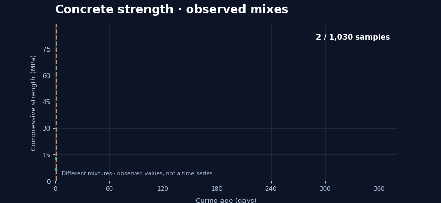

# 🏗️ Concrete Strength Prediction

**Regression & Classification | Machine Learning + Deep Learning (PyTorch)**

A beginner-friendly Jupyter Notebook project that predicts **concrete compressive strength (MPa)** and classifies concrete into four strength categories based on mixture ingredients and curing age.

The project addresses both problems from the original coursework and compares **seven classical machine learning models and one Artificial Neural Network (ANN)** for each task.

*The animation shows individual measured samples by curing age, not a time series of one concrete mixture.*

## Project Objectives

| Problem | Prediction Target | Evaluation Metrics |
|---|---|---|
| Regression | Concrete Strength (MPa) | MAE, RMSE, R² |
| Classification | Concrete Strength Class | Accuracy, Macro F1, Confusion Matrix |

## Dataset and Data Dictionary

The dataset contains **1,030 observations**, eight numerical input features, and one measured strength target, with no missing values.

| Feature | Description | Unit |
|---|---|---|
| Cement | Cement content | kg/m³ |
| Slag | Blast furnace slag | kg/m³ |
| FlyAsh | Fly ash | kg/m³ |
| Water | Water content | kg/m³ |
| Plasticizer | Superplasticizer content | kg/m³ |
| CoarseAgg | Coarse aggregate | kg/m³ |
| FineAgg | Fine aggregate | kg/m³ |
| Age | Curing age | Days |
| Strength | Concrete compressive strength | MPa |

## Project Workflow

- **Data Exploration:** Dataset inspection, distributions, correlations, and duplicate records.
- **Data Preparation:** Feature selection and 80/20 train-test split.
- **Regression:** Seven classical regression models and a PyTorch ANN.
- **Classification:** Four strength categories, seven classical classification models, and a PyTorch ANN.
- **Model Evaluation:** MAE, RMSE, R², Accuracy, Macro F1, and Confusion Matrix.

## Regression Models

- Linear Regression
- Ridge Regression
- K-Nearest Neighbors
- Decision Tree
- Random Forest
- Gradient Boosting
- Support Vector Regression
- Artificial Neural Network (PyTorch)

## Classification Models

- Logistic Regression
- K-Nearest Neighbors
- Decision Tree
- Random Forest
- Gradient Boosting
- Support Vector Classifier
- Naive Bayes
- Artificial Neural Network (PyTorch)

### Concrete Strength Classes

| Class | Strength |
|---|---|
| Non-structural | Below 17 MPa |
| Residential | 17 to below 28 MPa |
| Commercial | 28 to below 70 MPa |
| High-strength | 70 MPa and above |

The classification targets are derived from measured strength according to the assignment rules. The `Green` feature is also based on an assignment-specific rule and does not represent environmental certification.

Measured `Strength` is excluded from classification inputs to prevent target leakage.

## Model Results

The following results are taken from the executed Jupyter Notebook.

### Regression — Random Forest

| Metric | Result |
|---|---:|
| MAE | 3.759 MPa |
| RMSE | 5.528 MPa |
| R² | 0.881 |

**ANN Regression:** MAE 4.163 MPa, RMSE 5.950 MPa, R² 0.863.

### Classification — Random Forest

| Metric | Result |
|---|---:|
| Accuracy | 0.879 |
| Macro F1 | 0.804 |

**ANN Classification:** Accuracy 0.816, Macro F1 0.716.

**Key Finding:** Random Forest achieved the best performance in both tasks in this experiment. Deep Learning was also evaluated using small PyTorch neural networks.

## Limitations

This project is an educational baseline rather than a validated engineering tool.

The dataset is relatively small and contains repeated observations. Results are based on a single train-test split and may not generalize to new concrete mixtures.

Real-world applications would require more extensive validation, independent laboratory testing, and engineering assessment.

## Dataset Source and Attribution

**UCI Machine Learning Repository**

[Concrete Compressive Strength Dataset](https://archive.ics.uci.edu/dataset/165/concrete+compressive+strength)

**Original Publication**

I-Cheng Yeh (1998), *Modeling of strength of high performance concrete using artificial neural networks*, Cement and Concrete Research, Vol. 28, No. 12, pp. 1797–1808.

The original dataset documentation and attribution notice are retained in `Concrete_Readme.txt`.

